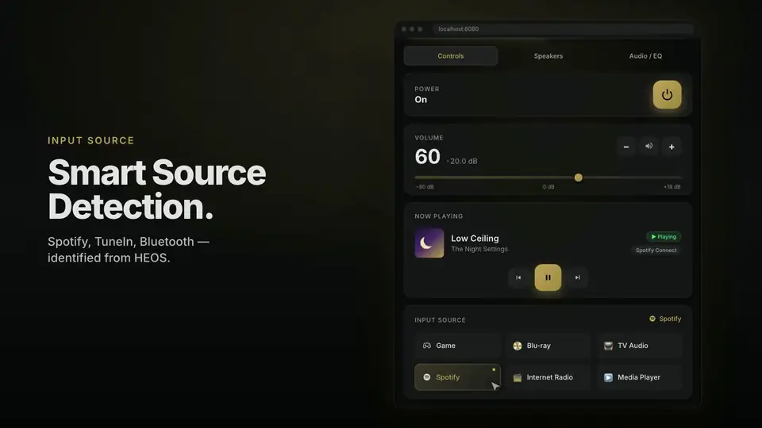
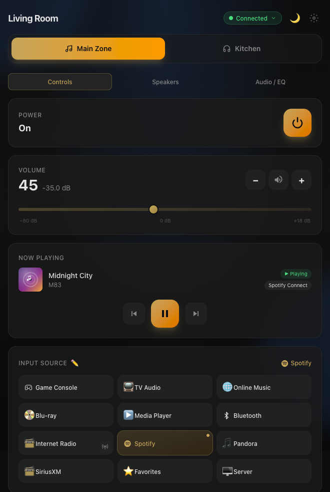
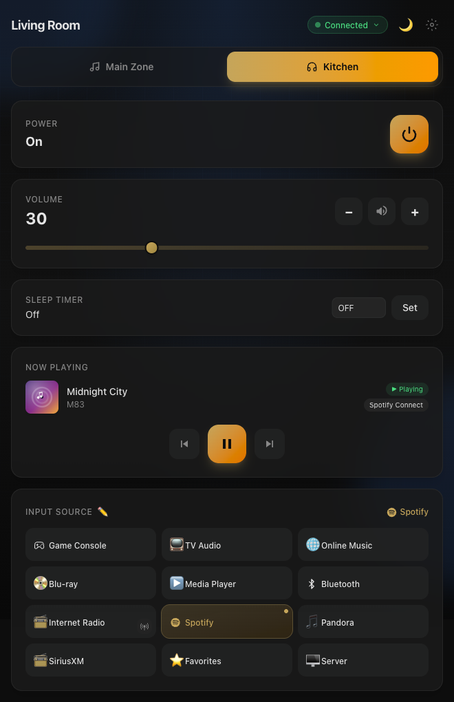
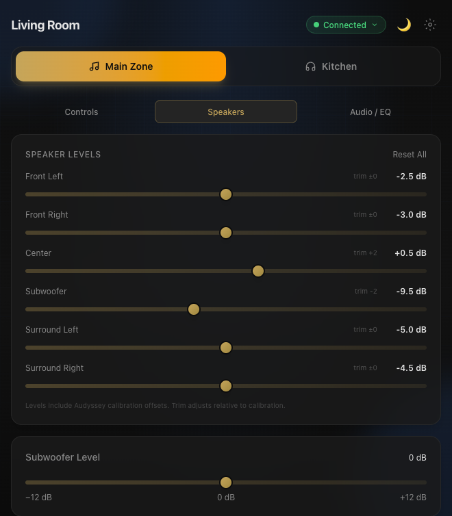
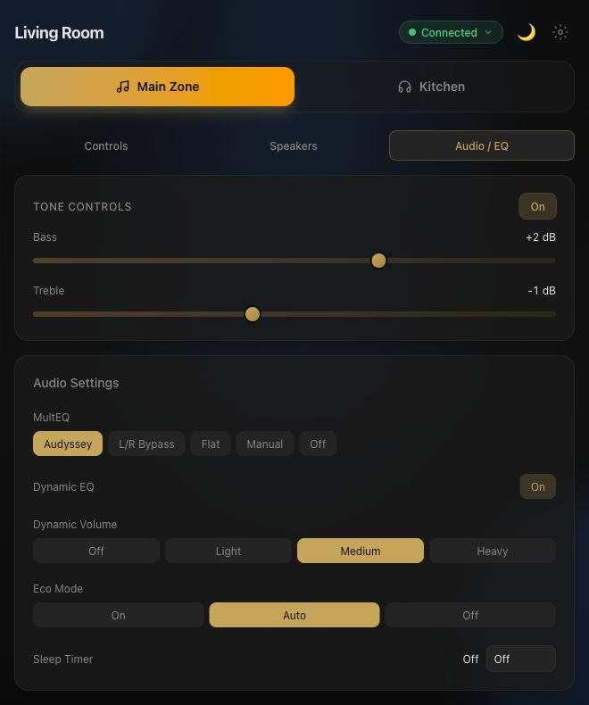
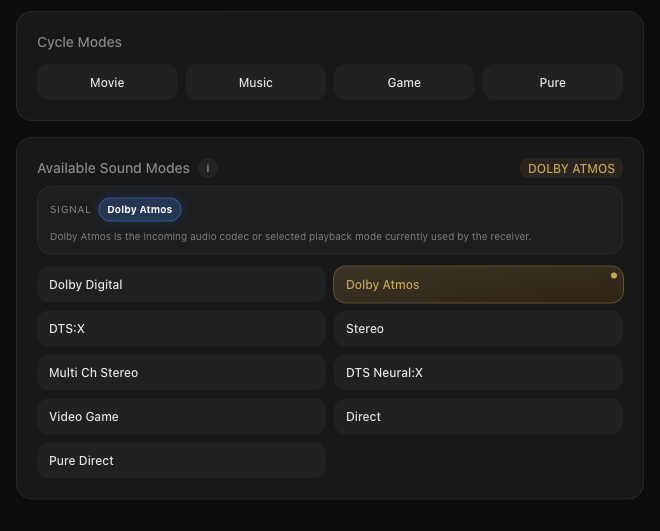
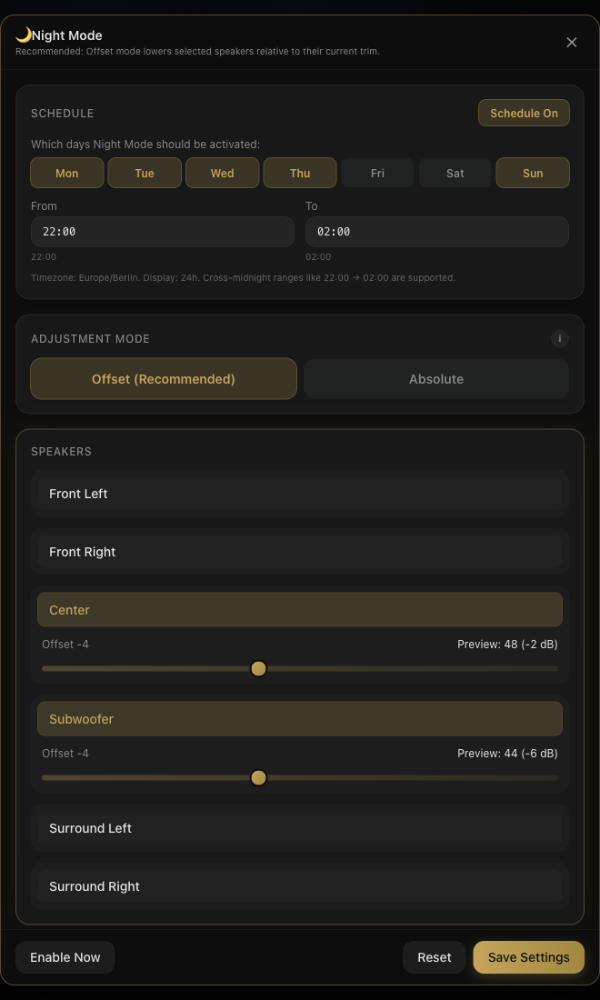
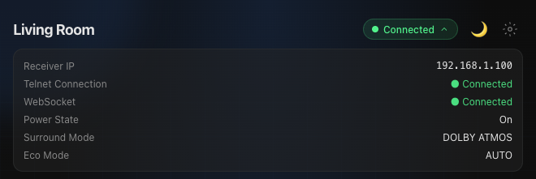

# Denon AVR Dashboard

A fast, modern web dashboard for Denon and Marantz AV receivers. It talks to the receiver directly over **telnet** and the **HEOS CLI**, so it keeps working when the receiver's own web interface doesn't.

[](https://github.com/OxygenLack/Denon-Marantz-AVR-Dashboard/actions/workflows/docker.yml) [](LICENSE)      [](https://github.com/OxygenLack/denon-dashboard-ha)

<div align="center">

<a href="docs/demo.mp4"></a>

<sub>▶ <a href="docs/demo.mp4">Watch with sound (MP4, 21s)</a></sub>

</div>

> **Disclaimer:** This is an unofficial, community-developed project. It is not affiliated with or endorsed by Denon, Marantz, or Sound United/Masimo. All product names and trademarks belong to their respective owners.

## Why this exists

Denon's built-in web UI is slow, breaks on firmware updates, and doesn't work well on phones. The receiver's telnet and HEOS protocols, on the other hand, are rock solid. This dashboard puts a clean, real-time interface on top of them: open it on any device on your network, and every change shows up everywhere instantly.

One Docker container. No cloud. No account. No app store.

## Table of contents

- [Screenshots](#screenshots)
- [Features](#features)
- [Quick start](#quick-start)
- [Configuration](#configuration)
- [Appearance](#appearance)
- [Keyboard shortcuts](#keyboard-shortcuts)
- [Home Assistant](#home-assistant)
- [REST API](#rest-api)
- [Development](#development)
- [Compatibility](#compatibility)
- [Known limitations and roadmap](#known-limitations-and-roadmap)
- [Contributing](#contributing)
- [License](#license)

## Screenshots

<div align="center">

| Controls | Zone 2 |
|:---:|:---:|
|  |  |
| **Speakers** | **Audio / EQ** |
|  |  |
| **Surround modes** | **Night Mode** |
|  |  |
| **Health panel** | |
|  | |

<sub>Screenshots taken in <a href="#demo-mode">demo mode</a> against the built-in mock receiver.</sub>

</div>

## Features

**Everyday control**
- Power, volume, mute, and input selection for the main zone and Zone 2
- Source buttons with icons and custom names. Rename them right in the UI; names persist and sync to every browser
- Play, pause, skip, and Now Playing with album art for HEOS and streaming sources. Shows stream quality where available (e.g. "AAC 128 kbps", "Spotify Connect")
- Smart source detection: when the receiver is on its generic network input, the dashboard figures out whether you're actually on Spotify, TuneIn, Bluetooth, etc. and highlights that instead
- Sleep timer for both zones

**Internet radio**
- Full TuneIn browser: local stations, trending, genres, sports, talk, podcasts, by location
- Around 800 stations preloaded at startup so search is instant. Results are cached server-side and shared by all clients
- Favorites, station logos, and country flags

**Sound**
- Surround mode picker with category cycling (Movie / Music / Game / Pure), current and next indicators, and an info mode that explains each mode's speaker layout and quirks. The mode list comes from your receiver, not a hardcoded table
- Per-speaker level trims shown on top of your Audyssey calibration, so you see the effective level
- Night Mode: a one-click per-speaker preset (absolute levels or offsets) that restores your previous levels when you turn it off
- Subwoofer level, bass and treble, MultEQ, Dynamic EQ, Dynamic Volume, Eco mode

**Quality of life**
- Real-time updates over WebSocket. Change the volume on the remote and every open tab follows
- Keyboard shortcuts for the common actions
- Installable as a PWA (Add to Home Screen, runs standalone)
- Nine accent themes, switchable from the UI and synced across devices
- Expandable health panel: receiver IP, connection status, power state, surround mode, eco mode
- Prometheus metrics endpoint for your monitoring stack

## Quick start

You need Docker and a Denon or Marantz receiver on the same network. Telnet control (port 23) must be enabled on the receiver; it usually is by default.

### 1. Create a `compose.yaml`

The simplest setup gives the dashboard your receiver's IP:

```yaml
services:
  denon-dashboard:
    image: ghcr.io/oxygenlack/denon-marantz-avr-dashboard:latest
    container_name: denon-dashboard
    restart: unless-stopped
    ports:
      - "8080:8080"
    volumes:
      - denon-dashboard-data:/data   # keeps renamed sources, favorites, Night Mode, theme
    environment:
      - DENON_DASHBOARD_DENON_HOST=192.168.1.100   # your receiver's IP

volumes:
  denon-dashboard-data:
```

The [`compose.yaml`](compose.yaml) in this repo is a more complete template with security hardening and commented-out options.

### 2. Start it

```bash
docker compose up -d
```

Open `http://YOUR_HOST:8080`. That's it.

### Don't know the receiver's IP?

Leave `DENON_DASHBOARD_DENON_HOST` empty and run the container with host networking:

```yaml
services:
  denon-dashboard:
    image: ghcr.io/oxygenlack/denon-marantz-avr-dashboard:latest
    container_name: denon-dashboard
    restart: unless-stopped
    network_mode: host          # required for auto-discovery
    volumes:
      - denon-dashboard-data:/data
    environment:
      - DENON_DASHBOARD_DENON_HOST=

volumes:
  denon-dashboard-data:
```

The dashboard starts right away with a "Searching…" screen, finds the receiver via SSDP (UPnP multicast), and connects on its own. No page refresh needed. If multicast is blocked on your network, it falls back to scanning the subnet for port 23, which takes about 30 seconds. If nothing turns up, a setup screen lets you type the IP by hand.

> Auto-discovery needs `network_mode: host` because Docker's default bridge network drops multicast. Host mode exposes all container ports on the host, so once you know the IP, switching back to the bridge setup above is the tidier option.

### Behind a reverse proxy

Any reverse proxy works; the dashboard is plain HTTP plus a WebSocket at `/api/v1/ws`. The repo's `compose.yaml` has commented-out Traefik labels as a starting point.

## Configuration

Everything is configured through environment variables prefixed with `DENON_DASHBOARD_`. There is also a [`.env.example`](.env.example) you can copy.

| Variable | Default | What it does |
|---|---|---|
| `DENON_HOST` | *(empty)* | Receiver IP. Leave empty to auto-discover (needs host networking). |
| `PORT` | `8080` | Port the dashboard listens on. |
| `DENON_TELNET_PORT` | `23` | Receiver telnet port. Rarely needs changing. |
| `DENON_HEOS_PORT` | `1255` | Receiver HEOS CLI port. Rarely needs changing. |
| `DENON_DEVICE_NAME` | `Denon AVR` | Name shown in the header. |
| `DENON_ZONE1_NAME` | `Main Zone` | Label for the main zone tab. |
| `DENON_ZONE2_NAME` | `Zone 2` | Label for the Zone 2 tab. |
| `DENON_SOURCE_NAMES` | `{}` | JSON object mapping source codes to display names, e.g. `{"GAME":"PlayStation 5"}`. Anything that is not a JSON object (a list, broken JSON) stops the container at startup. You can also rename sources in the UI. |
| `HEOS_SOURCES` | `true` | Add network sources (Bluetooth, Internet Radio, Spotify, …) to the source list. The receiver only reports physical inputs on its own. |
| `THEME` | `gold` | Default accent color. See [Appearance](#appearance). |
| `TIMEZONE` | `Europe/Berlin` | Timezone for schedules such as Night Mode. |
| `TIME_FORMAT` | `auto` | `auto`, `24h`, or `12h`. |
| `UI_AMBIENT_BACKGROUND` | `true` | Animated ambient background. |
| `UI_AMBIENT_INTENSITY` | `1.0` | Strength of the ambient background, roughly `0.0` to `2.0`. |
| `UI_SEASONAL_EFFECTS` | `auto` | `auto`, `off`, `winter`, `christmas`, or `halloween`. |
| `UI_SHORTCUT_OVERLAY` | `true` | Brief on-screen feedback when a keyboard shortcut fires. |
| `UI_CARD_ANIMATIONS` | `true` | Card hover glow and transitions. |
| `CORS_ORIGINS` | *(empty)* | Comma-separated allowed origins. Empty means same-origin only. Avoid `*`. |
| `LOG_LEVEL` | `INFO` | `DEBUG`, `INFO`, `WARNING`, or `ERROR`. `DEBUG` logs every telnet line. |
| `DEMO_MODE` | `false` | Run against a built-in fake receiver. See [Demo mode](#demo-mode). |
| `DATA_DIR` | `/data` | Where the persistent JSON files live. See [Persistent data](#persistent-data). |
| `STATIC_DIR` | `/app/static` | Directory with the built frontend. Only relevant outside the Docker image. |

All names in the table need the `DENON_DASHBOARD_` prefix, so `PORT` becomes `DENON_DASHBOARD_PORT`.

### Persistent data

The container stores UI source names, radio favorites, Night Mode settings, and the chosen theme as small JSON files in `/data`. Mount a volume there (as in the Quick start) so they survive restarts and updates.

### Finding your source codes

Source codes are the receiver's internal input identifiers. The common ones:

| Code | Default name | Input |
|---|---|---|
| `GAME` | Game | HDMI |
| `MPLAY` | Media Player | HDMI |
| `TV` | TV Audio | ARC / eARC |
| `BD` | Blu-ray | HDMI |
| `SAT/CBL` | SAT/Cable | HDMI |
| `8K` | 8K | HDMI 8K |
| `AUX1` | AUX1 | Auxiliary |
| `CD` | CD | Analog / digital |
| `TUNER` | Tuner | FM / AM |
| `NET` | Online Music | HEOS / network streaming |
| `BT` | Bluetooth | Bluetooth |

To see which codes your receiver uses, open a telnet session and switch inputs on the remote. Each change prints a line like `SIGAME` or `SITV`:

```bash
(while true; do sleep 1; done) | nc YOUR_RECEIVER_IP 23
```

## Appearance

### Themes

Pick an accent color from the theme picker in the dashboard header. The choice is saved to `/data` and pushed live to every open browser. `DENON_DASHBOARD_THEME` sets the default for a fresh install.

| Value | Color |
|---|---|
| `gold` | 🟡 Amber / gold *(default)* |
| `blue` | 🔵 Blue |
| `red` | 🔴 Red |
| `green` | 🟢 Green |
| `olive` | 🫒 Olive |
| `violet` | 🟣 Violet |
| `purple` | 💜 Purple |
| `pink` | 🩷 Pink |
| `orange` | 🟠 Orange |

### Effects

The ambient background, card animations, and shortcut overlay can each be switched off with the `UI_*` variables in the table above.

Seasonal overlays are on by default (`UI_SEASONAL_EFFECTS=auto`) and follow the calendar:

- Snow from December through February
- Christmas lights and snow from December 1 to 25
- Bats and ghosts from October 25 to 31

Set the variable to `off` to disable them, or to `winter`, `christmas`, or `halloween` to force one year-round.

## Keyboard shortcuts

Shortcuts work while the dashboard tab has focus. They are ignored when you're typing in a field or when the radio browser is open.

| Key | Action |
|---|---|
| `Space` | Play / pause |
| `↑` / `↓` | Volume up / down |
| `Shift` + `↑` / `↓` | Volume up / down in half steps (main zone only) |
| `M` | Toggle mute |
| `P` | Toggle power |
| `Z` | Switch between main zone and Zone 2 |

Shortcuts act on whichever zone is selected. Half steps are main-zone only because Denon's Zone 2 volume only moves in whole steps.

## Home Assistant

A companion integration, [denon-dashboard-ha](https://github.com/OxygenLack/denon-dashboard-ha), connects to this dashboard's API and creates a `media_player` entity for each zone: power, volume, source, surround mode, and playback.

Install it through [HACS](https://hacs.xyz/) by adding `https://github.com/OxygenLack/denon-dashboard-ha` as a custom repository, or copy `custom_components/denon_avr_telnet/` into your Home Assistant config directory.

## REST API

Everything the UI does goes through a JSON REST API under `/api/v1/`, so you can script the receiver with `curl`, Home Assistant, Node-RED, or anything else. POST endpoints accept JSON bodies.

```bash
# Set main zone volume
curl -X POST http://YOUR_HOST:8080/api/v1/volume \
  -H 'Content-Type: application/json' -d '{"level": 45}'

# Send any raw telnet command
curl -X POST http://YOUR_HOST:8080/api/v1/command \
  -H 'Content-Type: application/json' -d '{"command": "MVUP"}'
```

<details>
<summary><strong>Full endpoint reference</strong></summary>

### Status and setup

| Method | Endpoint | Description |
|---|---|---|
| `GET` | `/api/v1/health` | Health check |
| `GET` | `/api/v1/status` | Full receiver state: power, volume, source, channels, … |
| `GET` | `/api/v1/device` | Dashboard config: names, zones, `sources` (`id`, `name`, `default_name`), `channel_names` (canonical speaker order), `receiver_ip`, `media_sources`, `surround_categories` (`code`, `label`, `command`), `surround_modes`, theme, Night Mode config, radio favorites |
| `GET` | `/api/v1/channels` | Channel names and current levels |
| `GET` | `/api/v1/discover` | Scan the network for receivers via SSDP |
| `POST` | `/api/v1/connect` | Connect to a receiver IP (private LAN only). Body: `{"host": "192.168.1.100"}` (the old `{"command": …}` form is still accepted) |
| `POST` | `/api/v1/refresh` | Re-query the receiver's full state |
| `POST` | `/api/v1/command` | Send a raw telnet command. Body: `{"command": "MVUP"}` |
| `POST` | `/api/v1/ui-settings` | Save UI settings. Body: `{"theme": "purple"}` |
| `GET` | `/metrics` | Prometheus metrics (at the root, where scrapers expect it) |

Contract notes: the key set of `/api/v1/status` never shrinks. `/api/v1/device` only
grows too; since 2026-10 `receiver_ip` is `null` (not `""`) when no host is configured
or connected, and every `sources[]` entry carries `default_name` (the name without a
UI rename).

### Main zone

| Method | Endpoint | Body | Description |
|---|---|---|---|
| `POST` | `/api/v1/power/on` | | Turn on the main zone |
| `POST` | `/api/v1/power/off` | | Put the main zone in standby |
| `POST` | `/api/v1/power/toggle` | | Toggle main zone power |
| `POST` | `/api/v1/volume` | `{"level": 45.5}` | Set volume (0 to 98 in 0.5 steps, 80 is 0 dB) |
| `POST` | `/api/v1/volume/up` | | Volume up one step |
| `POST` | `/api/v1/volume/down` | | Volume down one step |
| `POST` | `/api/v1/mute/on` | | Mute |
| `POST` | `/api/v1/mute/off` | | Unmute |
| `POST` | `/api/v1/mute/toggle` | | Toggle mute |
| `POST` | `/api/v1/source` | `{"source": "GAME"}` | Select an input |
| `POST` | `/api/v1/source-names/{code}` | `{"name": "PlayStation 5"}` | Save a custom display name for a source |
| `DELETE` | `/api/v1/source-names/{code}` | | Reset a source name to the default |
| `POST` | `/api/v1/surround` | `{"mode": "STEREO"}` | Set surround mode |
| `POST` | `/api/v1/sleep` | `{"minutes": 30}` | Sleep timer |

### Speakers and audio

| Method | Endpoint | Body | Description |
|---|---|---|---|
| `POST` | `/api/v1/channel-volume` | `{"channel": "C", "level": 48}` | Set a channel trim (38 to 62, 50 is 0 dB) |
| `POST` | `/api/v1/channel-volume/reset` | | Reset all trims to 0 dB |
| `POST` | `/api/v1/night-mode` | `{"enabled": true, "channels": [{"channel": "SW", "mode": "absolute", "value": 38}]}` | Apply or lift the Night Mode preset |
| `GET` | `/api/v1/night-mode/config` | | Read the saved Night Mode preset |
| `POST` | `/api/v1/night-mode/config` | | Save the Night Mode preset |
| `POST` | `/api/v1/subwoofer-level` | `{"level": 50}` | Subwoofer level (38 to 62) |
| `POST` | `/api/v1/tone` | `{"enabled": true, "bass": 52, "treble": 48}` | Tone controls (at least one field; 44 to 56, 50 is 0 dB) |
| `POST` | `/api/v1/multeq` | `{"mode": "AUDYSSEY"}` | MultEQ mode |
| `POST` | `/api/v1/dynamic-eq` | `{"enabled": true}` | Dynamic EQ |
| `POST` | `/api/v1/dynamic-volume` | `{"mode": "MED"}` | Dynamic Volume: `OFF`, `LIT`, `MED`, `HEV` |
| `POST` | `/api/v1/eco` | `{"mode": "AUTO"}` | Eco mode: `ON`, `AUTO`, `OFF` |

### Zone 2

| Method | Endpoint | Body | Description |
|---|---|---|---|
| `POST` | `/api/v1/zone2/power/on` | | Turn on Zone 2 |
| `POST` | `/api/v1/zone2/power/off` | | Turn off Zone 2 |
| `POST` | `/api/v1/zone2/volume` | `{"level": 35}` | Set Zone 2 volume |
| `POST` | `/api/v1/zone2/volume/up` | | Volume up |
| `POST` | `/api/v1/zone2/volume/down` | | Volume down |
| `POST` | `/api/v1/zone2/mute/on` | | Mute |
| `POST` | `/api/v1/zone2/mute/off` | | Unmute |
| `POST` | `/api/v1/zone2/source` | `{"source": "NET"}` | Select an input |

The Zone 2 sleep timer is a plain telnet command (`Z2SLP030` for 30 minutes, `Z2SLPOFF` to cancel); send it through `/api/v1/command`.

### Media (HEOS)

| Method | Endpoint | Body | Description |
|---|---|---|---|
| `POST` | `/api/v1/media/play` | | Play |
| `POST` | `/api/v1/media/pause` | | Pause |
| `POST` | `/api/v1/media/stop` | | Stop |
| `POST` | `/api/v1/media/next` | | Next track |
| `POST` | `/api/v1/media/previous` | | Previous track |
| `GET` | `/api/v1/media/now-playing` | | Current track and play state |

### Internet radio

| Method | Endpoint | Parameters / body | Description |
|---|---|---|---|
| `GET` | `/api/v1/media/radio/browse` | `?cid=…` (optional) | Browse the TuneIn directory. Omit `cid` for the top level |
| `GET` | `/api/v1/media/radio/search` | `?q=jazz+berlin` | Search cached stations. All words must match |
| `GET` | `/api/v1/media/radio/status` | | Diagnostics: `ready`, `reason`, `heos_connected`, `account_signed_in`, `tunein_available`, `cached_stations`, `preloading` (station preload running) |
| `POST` | `/api/v1/media/radio/play` | `{"mid": "s280354"}` | Play a station by TuneIn ID |
| `POST` | `/api/v1/media/radio/refresh` | | Clear the cache and preload again (single-flight; returns `{"ok", "started", "preloading"}`) |
| `GET` | `/api/v1/media/radio/favorites` | | List favorites |
| `POST` | `/api/v1/media/radio/favorites` | `{"mid": "s280354", "name": "Radio Paradise", "image_url": "…"}` | Add a favorite |
| `DELETE` | `/api/v1/media/radio/favorites/{mid}` | | Remove a favorite |

### WebSocket

Connect to `/api/v1/ws` for live updates. The server pushes the complete state object on every change.

```javascript
const ws = new WebSocket('ws://YOUR_HOST:8080/api/v1/ws')
ws.onmessage = (e) => console.log(JSON.parse(e.data))
```

The state object is the same one `GET /api/v1/status` returns. Abridged:

```json
{
  "connected": true,
  "heos_connected": true,
  "power": true,
  "volume": 45.0,
  "muted": false,
  "source": "NET",
  "source_name": "Spotify",
  "heos_source": "SPOTIFY",
  "surround_mode": "DOLBY ATMOS",
  "channel_volumes": {"FL": 50, "FR": 50, "C": 48, "SW": 52},
  "speaker_calibration": {"FL": -2.5, "FR": -3.0},
  "now_playing": {"song": "Midnight City", "artist": "M83", "image_url": "https://…"},
  "play_state": "play",
  "stream_quality": "Spotify Connect",
  "z2_power": false
}
```

`connected` is the telnet control link, `heos_connected` the HEOS CLI link (media transport,
Now Playing, radio). Fields are only ever added, never renamed or removed. Browsers must
send an `Origin` matching the page's host (or one listed in `CORS_ORIGINS`); non-browser
clients can omit it.

</details>

<details>
<summary><strong>Denon telnet protocol notes</strong></summary>

Useful if you're building something on top of this or debugging with `nc`:

- **Line terminator** is `\r` (0x0D), not `\r\n`.
- **Command spacing:** wait at least 50 ms between commands, and about 1 s after power-on.
- **Volume:** `MV50` is -30 dB, `MV80` is 0 dB. A third digit means a half step: `MV805` is 80.5.
- **Channel trims:** `CV` values run 38 to 62, with 50 meaning 0 dB on top of the Audyssey calibration.
- **Power:** `PW` is system power (any zone), `ZM` is the main zone only. When only Zone 2 is on, the receiver reports `PWON` together with `ZMOFF`.
- **Zone 2 sleep:** `Z2SLP030` is 30 minutes, `Z2SLPOFF` cancels.
- **Night Mode** in this dashboard snapshots the current `CV` trims before applying the preset and restores that snapshot when disabled.
- **HEOS CLI** is line-delimited JSON on port 1255, e.g. `heos://player/set_play_state?pid=X&state=play`.

</details>

## Development

### Run locally

```bash
# Backend (FastAPI)
cd backend
pip install -r requirements.txt
DENON_DASHBOARD_DENON_HOST=192.168.1.100 python -m uvicorn main:app --reload --port 9999

# Frontend (Vite dev server, proxies /api to the backend)
cd frontend
npm install
npm run dev
```

### Demo mode

No receiver handy? Set `DENON_DASHBOARD_DEMO_MODE=true` and the backend serves a fully populated fake receiver over the real WebSocket. Power, volume, sources, surround modes, channel levels with Audyssey offsets, a Now Playing track, Zone 2: every part of the UI works against simulated data. The screenshots in this README were taken this way.

```bash
cd backend
DENON_DASHBOARD_DEMO_MODE=true python -m uvicorn main:app --reload --port 9999
```

Demo mode can only be enabled through this environment variable. There is no URL parameter or client-side switch, so it can't be turned on by accident in production. When it's on, `DENON_HOST` and network discovery are skipped.

### Tests, lint and type checks

```bash
cd backend && ruff check . && pytest
cd frontend && npm run lint && npm test && npm run typecheck
```

Backend: pytest (asyncio auto mode) and ruff, both configured in `backend/pyproject.toml`.
Frontend: oxlint (`.oxlintrc.json`) and Vitest with Testing Library (`src/**/*.test.ts(x)`).
The frontend is strict TypeScript. `npm run build` runs the type check first, so type errors fail the build; `scripts/check-css-bundle.py` then checks that the built CSS still contains the Tailwind utilities.

### Build the image

```bash
docker build -t denon-dashboard .
```

The Dockerfile builds the frontend in a Node stage and serves it from the FastAPI container, so the result is a single image.

## Compatibility

Tested with:

- **Denon AVR-X2700H** (firmware 3.88.614)
- **Marantz Cinema 60**

It should work with any Denon or Marantz receiver that offers telnet control on port 23. Media controls and Now Playing additionally need the HEOS CLI on port 1255, which every HEOS-capable model has. If you try another model, please open an issue and say how it went, whether it worked or not.

## Known limitations and roadmap

### Known limitations

- **Switching between HEOS services isn't possible over telnet.** The receiver reports Bluetooth, Spotify, Internet Radio, and the rest all as the single `NET` input. The dashboard detects and highlights the active service correctly, but the source buttons can't force a switch from, say, Spotify to Bluetooth. ([#2](https://github.com/OxygenLack/Denon-Marantz-AVR-Dashboard/issues/2))

### Planned

- **Tactile transducer channel** on the speaker page ([requested on Reddit](https://reddit.com/r/hometheater/comments/1syh2mn/i_got_tired_of_denons_broken_web_ui_so_i_built_my/oiwg22o/))
- **Dirac Live filter slot switching** for receivers with Dirac ([requested on Reddit](https://reddit.com/r/hometheater/comments/1syh2mn/i_got_tired_of_denons_broken_web_ui_so_i_built_my/oixqkvf/))
- **HEOS speaker grouping** ([#6](https://github.com/OxygenLack/Denon-Marantz-AVR-Dashboard/issues/6))
- **Audyssey preset switching** (Preset 1 / Preset 2)
- Feature parity with the original Denon/Marantz web UI

## Contributing

Bug reports, feature requests, and pull requests are all welcome. If you're adding support for a receiver feature, a short telnet capture of the relevant commands and responses in the issue helps a lot.

- Open an [issue](https://github.com/OxygenLack/Denon-Marantz-AVR-Dashboard/issues) for bugs and ideas
- Run the backend tests and the frontend type check before opening a PR (see [Tests and type checks](#tests-and-type-checks))

## License

[MIT](LICENSE)
